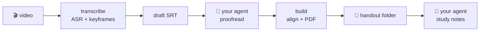

# Chalkpress

**One sentence to your AI agent: turn lecture videos into a handout PDF**

Exam-prep lectures (grad-school entrance, professional certifications, university courses): a 30-minute video → a 5-minute read. Fully local, zero API keys.

[Quick Start](#-quick-start) · [How It Works](#-how-it-works) · [Privacy](#-privacy) · [FAQ](#-faq) · [中文](./README.md)

---

## Why

The painful part of exam-prep videos is not watching — it's **finding things again**. Which lecture covered this exam point? Scrubbing from memory. Chalkpress compresses a course into a **handout**: skimmable, searchable, printable.

| Scenario | Watching | Reading the handout |
|----------|----------|---------------------|
| First pass | 30 min of linear playback | **~5 min**: flip through keyframe pages, framework first |
| Wrong answer → source lecture | Scrubbing from memory | Full-text search, instant hit |
| Sprint review | Re-watch the whole lecture | Only the weak pages; timestamps link back to the exact minute |
| Print & memorize | Impossible | One knowledge visual per page |

## 🚀 Quick Start

Send this sentence to your AI agent (workbuddy / ChatGPT / Claude Code — anything that can run commands):

> **Use this skill to turn my lecture video into a handout PDF: https://github.com/luolin1024/chalkpress-skill**

The agent follows [SKILL.md](SKILL.md) and does the rest: fetch the skill → install deps on demand → transcribe → **proofread subtitles** → build the PDF → **write study notes**. The two LLM steps are done by your agent's own intelligence — **no API keys, no configuration**.

## 🧠 How It Works

The deterministic Python pipeline owns every mechanical step; LLM judgment belongs to your agent.

You get: `<video>.pdf` (keyframe pages + aligned subtitles, searchable text layer), the polished `.srt`, `.aligned.md` (subtitles × frames side by side), optional `summary.md` (agent-written study notes), `keyframes/`, and `manifest.json` — `build` consumes only manifest + frames, so it reruns anywhere without ffmpeg.

## 🔒 Privacy

Videos **never leave your machine** — transcription, keyframe extraction, and PDF layout all run locally; the pipeline makes zero network calls (first Whisper model download excepted).

## ❓ FAQ

<b>Why no API key?</b>

Your agent <em>is</em> the LLM. The pipeline stays purely mechanical; proofreading and note-writing happen in the agent's own context, on your own machine.

<b>How fast is transcription?</b>

CPU int8 runs ~2–4× realtime; Apple Silicon gets mlx-whisper GPU acceleration automatically.

<b>English lectures?</b>

Yes — Whisper auto-detects 90+ languages. The PDF's framework labels are Chinese by design; notes language is whatever you and your agent agree on.

## 📄 License

[Apache-2.0](LICENSE).

---

**Find this useful? Give it a ⭐**

