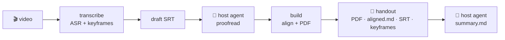
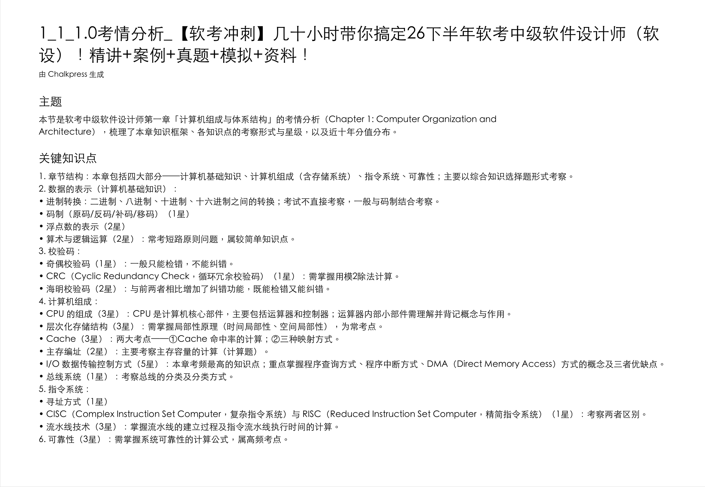

<div align="center">


# Chalkpress

**Turn lecture videos into a searchable, printable handout PDF**

**A 30-minute lecture → a 5-minute read**: scene-detected keyframe pages replace scrubbing, subtitles travel with their slide, review by search instead of rewatching — orchestrated by your AI agent, fully local, zero API keys.

[](https://github.com/luolin1024/chalkpress-skill/actions/workflows/ci.yml)
[](https://github.com/luolin1024/chalkpress-skill/releases)
[](LICENSE)
[](pyproject.toml)

[Quick Start](#-quick-start) · [How It Works](#-how-it-works) · [Features](#-features) · [FAQ](#-faq) · [中文](./README.md)

</div>

---

## Why

The painful part of video lectures is not watching — it's **finding things again**. Chalkpress compresses a lecture into a **handout**: skimmable, searchable, printable.

| Scenario | Watching | Reading the handout |
|----------|----------|---------------------|
| First pass | 30 min of linear playback | **~5 min**: flip through keyframe pages, read framework first |
| Reviewing a topic | Scrubbing from memory | Full-text search, **instant hit** |
| Only weak spots | Re-watch the whole thing | Jump to the pages; timestamps link back to the exact minute |
| Print & annotate | Impossible | One knowledge visual per page, print and carry |

## ✨ Features

- 🎯 **Keyframe pages** — ffmpeg scene detection (content-driven, not fixed intervals) + average-hash dedup
- 📝 **Aligned subtitles** — local Whisper transcription (faster-whisper / mlx-whisper) binned into each frame's time window
- 🤖 **Agent-native** — proofreading and the illustrated study summary are done by your AI agent (Claude Code, etc.) with its own intelligence. **No API keys, no cloud calls**
- 🧩 **Term packs as data** — deterministic pinyin-window homophone correction (ship a JSON to support a new domain)
- 🔒 **Fully local** — zero network calls in the pipeline itself (first Whisper model download excepted)
- 🪶 **On-demand deps** — 4 extras groups; existing SRT means no Whisper install, no model download

## 🚀 Quick Start

**As an agent skill (recommended):**

```bash
# Claude Code (skills dir: ~/.claude/skills/)
git clone https://github.com/luolin1024/chalkpress-skill.git ~/.claude/skills/chalkpress-skill
# Other SKILL.md-aware agents (Hermes, OpenCode, ...): clone into their skills dir
```

Then just ask your agent: *"turn this lecture video into a handout"*. It follows [SKILL.md](SKILL.md): install deps → transcribe → **proofread** → build → **write the summary**.

**As a CLI:**

```bash
pip install -e ".[zh,asr]"
chalkpress transcribe lecture.mp4 --language zh --term-fix   # → draft SRT + keyframes/
chalkpress build lecture.mp4                                 # → aligned.md + PDF
```

## 🧠 How It Works



The deterministic pipeline owns every mechanical step; LLM judgment belongs to the host agent ([ADR-0001](docs/adr/0001-llm-belongs-to-host-agent.md)). `build` consumes only `manifest.json` + keyframes — no ffmpeg, rerun anywhere ([ADR-0002](docs/adr/0002-two-phase-cli.md)).

## 🖼️ What You Get

**AI study notes** — the host agent distills each section into an exam-point outline with star weights (embedded as the PDF's optional first page; framework labels are Chinese by design):



One conversion leaves you with a handout folder: `lecture.pdf` (keyframe pages + aligned subtitles, searchable text layer), `lecture.aligned.md` (subtitles × keyframes side by side), the polished `.srt`, `keyframes/`, and `manifest.json` (timestamps only — `build` reruns anywhere).

## 🆚 How It Compares

| | Chalkpress | Meeting-transcript tools (Feishu Minutes, etc.) | Generic transcription |
|---|-----------|---------------|-------------|
| Output | **Handout PDF** (frame + subtitles on one page) | plain transcript | plain text |
| Printable & searchable | ✅ real text layer | ❌ | ❌ |
| Structured summary | ✅ agent-written notes | ❌ | ❌ |
| Review | search → page → timestamped replay | scroll a long transcript | scroll |
| Video upload | **never leaves your machine** | cloud upload required | varies |
| API key | **not needed** | platform account | usually required |

## 🔒 Privacy

Videos **never leave your machine** — transcription, keyframe extraction, and PDF layout all run locally; the pipeline itself makes zero network calls (first Whisper model download excepted). Subtitles and keyframes exist only inside your own agent session. Confidential or internal training videos are fine too.

## ❓ FAQ

<details>
<summary><b>Why no API key?</b></summary>

Your agent <em>is</em> the LLM. The pipeline stays purely mechanical; proofreading and summarizing happen in the agent's own context, on your own machine.
</details>

<details>
<summary><b>How fast is transcription?</b></summary>

CPU int8 runs ~2–4× realtime; Apple Silicon gets mlx-whisper GPU acceleration automatically.
</details>

<details>
<summary><b>Privacy?</b></summary>

Videos never leave your machine. The pipeline makes zero network calls (first Whisper model download excepted).
</details>

<details>
<summary><b>Prefer a desktop app?</b></summary>

Chalkpress also ships as a [desktop application](https://github.com/luolin1024/chalkpress) (Windows / macOS / Linux, drag-and-drop). Same handout philosophy, separate repos.
</details>

## 📄 License

[Apache-2.0](LICENSE).

---

<div align="center">

**Find this useful? Give it a ⭐**

</div>
