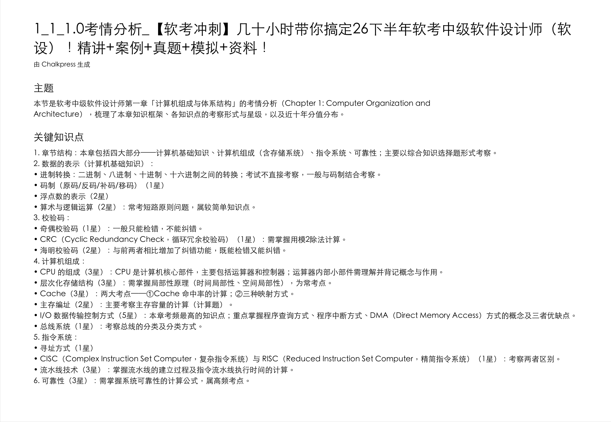

<div align="center">


# Chalkpress

**把讲座视频变成一册可检索、可打印的讲义 PDF**

**30 分钟的课 → 5 分钟读完**：关键帧成页代替拖进度条，字幕随页即上下文，复习靠搜索不靠重看 —— 而这一切由你的 AI Agent 编排，全程本地，零 API Key。

[](https://github.com/luolin1024/chalkpress-skill/actions/workflows/ci.yml)
[](https://github.com/luolin1024/chalkpress-skill/releases)
[](LICENSE)
[](pyproject.toml)
[](https://github.com/luolin1024/chalkpress-skill/stargazers)

[快速开始](#-快速开始) · [工作原理](#-工作原理) · [特性](#-特性) · [效果](#-效果) · [隐私](#-隐私) · [常见问题](#-常见问题) · [English](./README.en.md)

</div>

---

## 为什么

看网课最痛的不是"看"，是**回头找**：视频没法检索、没法打印、拖进度条全靠记忆。Chalkpress 把一场讲座**压缩成一册讲义**——阅读从此可以跳读、搜读、打印读：

| 场景 | 看视频 | 读讲义 |
|------|--------|--------|
| 第一次抓重点 | 30 分钟线性播放，重点在哪只能等 | **约 5 分钟**：翻关键帧页扫读，抓框架再补细节 |
| 复习找某个知识点 | 拖进度条靠记忆，来回试 | 关键词全文检索，**秒级定位到页** |
| 只想补薄弱的几段 | 几乎只能重看整节 | 只翻对应几页；需要听语气，按页内时间戳回看那 1~2 分钟 |
| 打印批注 / 纸质复习 | 不可能 | 一页一个知识画面，直接打印随身复习 |

> 讲义不是替代看课，而是把「看完」和「记住 / 找到」解耦：通读交给阅读，回看交给时间戳。

## ✨ 特性

| | 特性 | 说明 |
|---|------|------|
| 🎯 | **关键帧成页** | 场景检测驱动抽帧：内容变化才截页，不是机械等间隔；平均哈希去重 |
| 📝 | **字幕随页** | Whisper 本地转写（faster-whisper / mlx-whisper），字幕对齐到所在画面的时间窗 |
| 🤖 | **Agent 原生** | 字幕校对与图文摘要交给你的 AI Agent（Claude Code 等）用自己的模型完成——**零 API Key、零外呼** |
| 🧩 | **术语包即数据** | 软考等领域的同音字误听按拼音滑窗确定性修正（坚偶校验 → 奇偶校验、生存数 → 生成树）；新领域只需加一个 JSON |
| 🔒 | **全程本地** | 转写、抽帧、排版全在你机器上；管线自身零网络调用（whisper 模型首次下载除外） |
| 🪶 | **按需安装** | 依赖分 4 组 extras：已有 SRT 就不用装 whisper（省下数百 MB 模型），中文视频才装繁简转换 |
| 🖨️ | **可检索 PDF** | reportlab 排版，画面为图、字幕/摘要为真实文字层；CJK 字体三平台解析链不缺字 |

## 🚀 快速开始

### 方式一：作为 Agent 技能（推荐）

把仓库放进你的 agent 技能目录，然后直接用自然语言指挥：

```bash
# Claude Code：clone 进其技能目录
git clone https://github.com/luolin1024/chalkpress-skill.git ~/.claude/skills/chalkpress-skill
# 其他支持 SKILL.md 的 agent（Hermes / OpenCode 等）：clone 进各自技能目录即可
```

> 对 Claude Code / 其他支持 SKILL.md 的 agent 说："**把这个课程视频转成讲义**"——agent 会按 [SKILL.md](SKILL.md) 自己完成：装依赖 → 转录 → **校对字幕** → 构建 → **写图文摘要**。两步 LLM 工作是 agent 用自己的智能做的，不需要任何 API 配置。

### 方式二：作为 CLI 直接用（人类）

```bash
pip install -e ".[zh,asr]"        # 中文视频 + 本地转录；macOS Apple 芯片把 asr 换成 mac
chalkpress transcribe 课程.mp4 --language zh --term-fix
#   → 课程_讲义/：课程.srt（草稿字幕）+ keyframes/ + manifest.json

# 校对 课程.srt（只改文本，不动时间轴；这一步交给 agent 或你手动）
chalkpress build 课程.mp4
#   → 课程.aligned.md（字幕×关键帧对照）+ 课程.pdf
```

**已有字幕？** `--reuse-srt` 跳过转写，不装 asr、不下载模型：

```bash
chalkpress transcribe 课程.mp4 --reuse-srt 已有.srt
```

**摘要嵌入 PDF 首页**：agent 写完 `课程.summary.md` 后，`chalkpress build 课程.mp4 --summary 课程_讲义/课程.summary.md`。

多视频没有内置批量——让 agent 循环调用即可，单个失败不影响后续。

### 依赖分组（按需安装，绝不全量）

| 依赖组 | 内容 | 何时需要 |
|---|---|---|
| base（默认） | pillow, reportlab, imageio-ffmpeg | 任何转换 |
| `zh` | opencc, pypinyin | 中文视频：繁简规范、软考术语修正 |
| `asr` | faster-whisper | 无现成 SRT 时本地转录 |
| `mac` | mlx-whisper | Apple 芯片转录加速（替代 asr） |
| `dev` | pytest | 开发 |

## 🧠 工作原理

确定性 Python 管线负责一切机械工作，LLM 判断力由宿主 agent 提供——职责单向、边界干净：


一次转换的交付物：

| 你得到 | 说明 |
|--------|------|
| `<视频名>.pdf` | 每页一个关键帧画面 + 该时间窗的字幕（可选摘要首页），**文字层可检索可复制** |
| `<视频名>.srt` | 全片字幕（校对后），可独立导入播放器 |
| `<视频名>.aligned.md` | 字幕×关键帧对照表（Markdown，内嵌关键帧图） |
| `<视频名>.summary.md` | agent 撰写的结构化学习笔记（可选） |
| `keyframes/` | 讲义页原图，随时复用 |
| `manifest.json` | 帧时间戳与时长，build 阶段的唯一交接物——**build 不依赖 ffmpeg，可在任何环境重跑** |

## 🖼️ 效果

**AI 学习笔记** —— 软考软设「考情分析」一节，agent 自动提炼出带星级权重的考点结构（摘要即 PDF 可选首页）：



**一次转换的讲义目录**：

```text
课程_讲义/
├── 课程.pdf            # 讲义本体：关键帧成页 + 字幕随页（可含摘要首页）
├── 课程.aligned.md     # 字幕 × 关键帧对照（图片内嵌，可直接阅读）
├── 课程.srt            # 全片字幕（校对后）
├── 课程.summary.md     # agent 学习笔记
├── keyframes/          # 00_00m00s.jpg …（讲义页原图）
└── manifest.json       # 帧时间戳 / 时长 / 语言
```

## 🆚 与常见工具的区别

| | Chalkpress | 剪映 / 飞书妙记 | 通用转写工具 |
|---|-----------|---------------|-------------|
| 产出形态 | **讲义 PDF**（画面+字幕同页） | 转文字稿 | 纯文字 |
| 可打印可检索 | ✅ 文字层 PDF | ❌ | ❌ |
| 结构化总结 | ✅ agent 图文笔记 | ❌ | ❌ |
| 复习方式 | 搜关键词定位到页，按页回看 | 在长文字稿里翻找 | 翻找 |
| 视频上传 | **永不上传** | 需上传云端 | 视本地实现 |
| API Key | **不需要** | 平台账号 | 多数需要 |

## 🔒 隐私

视频**始终不上传**——转写、抽帧、排版全程在你机器上完成，管线自身零网络调用（whisper 模型首次下载除外）。字幕与关键帧只出现在你自己的 agent 会话里。课程内容涉密、未公开内部培训视频，同样可用。

## ❓ 常见问题

<details>
<summary><b>为什么不需要 API Key？校对和总结谁做的？</b></summary>

你的 AI Agent（Claude Code 等）本身就是 LLM——它按 SKILL.md 的指引读取草稿字幕自行校对、阅读对齐稿和关键帧图片撰写摘要。管线只做机械工作：转录、抽帧、对齐、排版。这也是本项目与"套壳调 API"工具的本质区别。
</details>

<details>
<summary><b>转写速度多快？</b></summary>

CPU int8 下约实时速度的 2-4 倍；macOS Apple 芯片自动启用 mlx-whisper GPU 加速。`--speed turbo` 用满全部核心（仅 faster-whisper 后端）。
</details>

<details>
<summary><b>"30 分钟 → 5 分钟"夸张吗？</b></summary>

以**课件型网课**（PPT 录播、概念讲解为主）为典型场景：讲义页数 ≈ 课件页数，翻页扫读确实能把"通览一节课"从 30 分钟压到 5 分钟上下。推导密集的内容压缩比会低一些——但讲义依然先给你地图，让你把时间只花在值得的段落。
</details>

<details>
<summary><b>支持英文视频吗？</b></summary>

支持。Whisper 支持 90+ 语种自动识别；摘要语言由 agent 与你约定。PDF 框架标签固定为中文。
</details>

<details>
<summary><b>隐私如何保证？</b></summary>

视频**始终不上传**——转写、抽帧、排版全程本地，管线自身零网络调用（whisper 模型首次下载除外）。字幕与关键帧只出现在你自己的 agent 会话里。
</details>

<details>
<summary><b>想要桌面应用？</b></summary>

Chalkpress 还有 [桌面版](https://github.com/luolin1024/chalkpress)（Windows / macOS / Linux 安装包，拖入即转 + 任务看板 + 应用内更新），适合不使用 agent 的工作流。两个仓库共享同一套讲义管线理念，互不依赖。
</details>

## 🏗️ 技术要点

- **两段子命令**：`transcribe`（唯一持有 ffmpeg 的阶段）→ `build`（纯 Python，消费 `manifest.json` + 关键帧，随时重跑）；SRT 是 agent 校对的介入点（[ADR-0002](docs/adr/0002-two-phase-cli.md)）
- **管线零 LLM**：校对与摘要全部宿主化，`requests` 依赖归零（[ADR-0001](docs/adr/0001-llm-belongs-to-host-agent.md)）
- **本地 ASR**：faster-whisper（CPU int8 全平台）+ mlx-whisper（Apple 芯片 GPU），重依赖全部函数内懒加载、缺失即给安装指引
- **关键帧**：ffmpeg 场景检测 + 段首/段末取样 + 平均哈希去重，课件型课程 30 分钟通常只出 30~40 页
- **可检索 PDF**：reportlab 横版 A4，CJK 字体解析链三平台不缺字

## 🗺️ 路线图

- [x] 两段子命令 + manifest 交接（build 无 ffmpeg 依赖）
- [x] 依赖按需分组（extras），已有 SRT 零模型下载
- [x] 内置软考术语包（241 条，拼音滑窗确定性修正）
- [ ] 更多领域术语包（医学 / 法考 / 考研…—— 欢迎 PR，只需加 JSON）
- [ ] CUDA / GPU 转写后端
- [x] 双语 README（[英文精简版](README.en.md)）
- [ ] 发布到主流 agent 技能市场

## 🤝 参与贡献

欢迎 PR！特别是：

- **术语包**：往 [`chalkpress/scene_packs/`](chalkpress/scene_packs/) 加一个 `{scene, terms, direct}` JSON，就是对新领域的完整支持——引擎零改动
- 文档 / FAQ / 英文翻译
- 管线改进请先跑 `pytest tests/ -q`，并遵守 [AGENTS.md](AGENTS.md) 的两条不变量（build 不依赖 ffmpeg；管线零 LLM）

## 📄 许可

[Apache-2.0](LICENSE)。桌面版采用不同许可，见[其仓库](https://github.com/luolin1024/chalkpress)。

---

<div align="center">

**觉得有用？给个 ⭐ 让更多人看到**

[SKILL.md](SKILL.md) · [桌面版](https://github.com/luolin1024/chalkpress) · [问题反馈](https://github.com/luolin1024/chalkpress-skill/issues)

</div>
